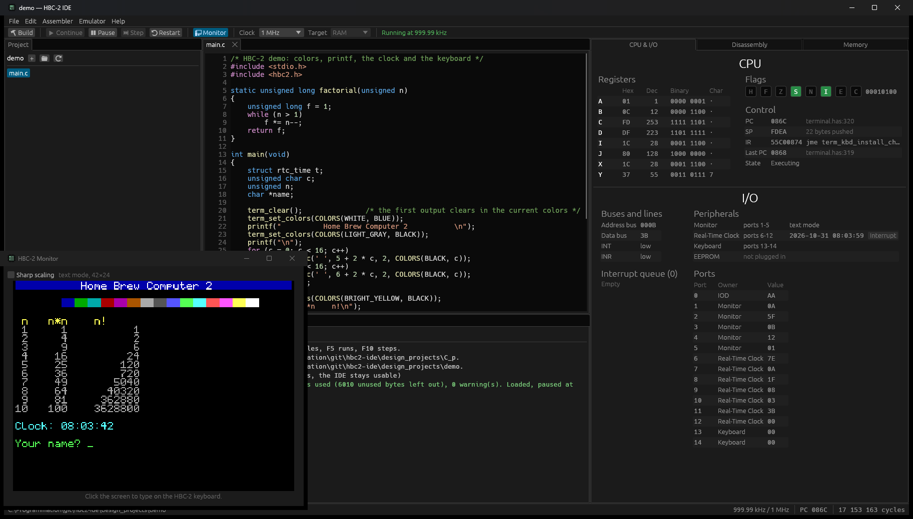

# Home Brew Computer 2 - Integrated Development Environment
This repository hosts all of my HBC-2 project files.

It contains documentation about the computer design and an IDE built around a custom assembly language.
The IDE also integrates a basic C89 compiler (incomplete).

## Computer design
The HBC-2 is an 8-bit computer with 64 KB of RAM, a 256 * 192 pixels monitor and a real-time clock.

### Documentation
Documentation about the computer's design is available [here](https://github.com/SteriCraft/hbc2-ide/tree/main/Documentation).\
How to build and use the IDE: [hbc2/README.md](hbc2/README.md).\
The assembly language: [HBC-2 Assembly Language](Documentation/HBC-2%20Assembly%20Language.md).

## Integrated Development Environment

The IDE (written in Rust) lets you write programs in HBC-2 assembly or in C, build them, and run them on an emulator of the computer.

The C compiler is based on the [Fuzix Compiler Kit](https://github.com/EtchedPixels/Fuzix-Compiler-Kit).
